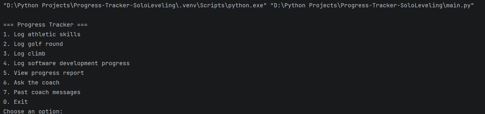
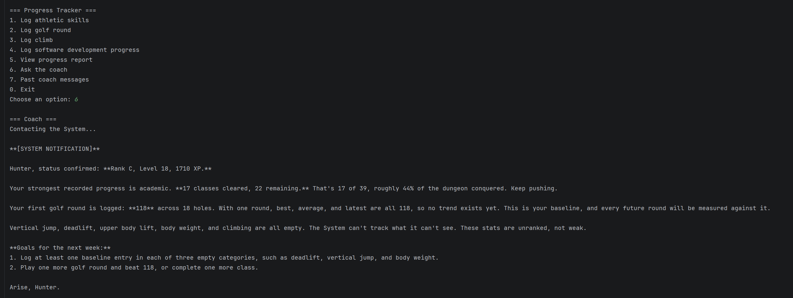
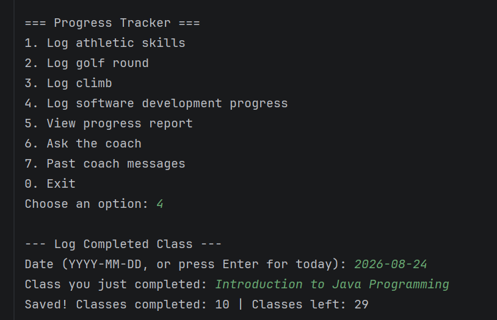
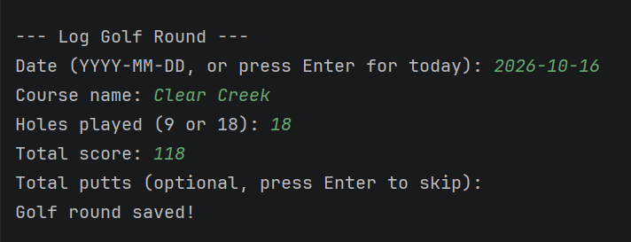
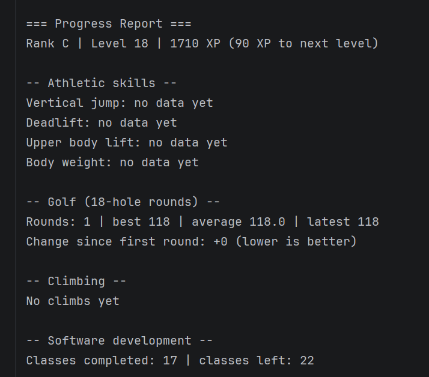

# Progress Tracker: Solo Leveling Edition

A Python command-line app that tracks my progress in golf, climbing,
athletic performance, and my software degree. It turns the data into
personal records, trends, and a Solo Leveling style XP, level, and rank
system, and uses the Claude API to write a short weekly coach message.

## Why I built it
I wanted one place to see whether I'm actually improving, but using solo leveling(anime)
as inspiration to create the whole system around and make it fun as I progress. It also gave me
a project to practice SQL, testing, and working with an LLM API.

## Features
- Log athletic skills (vertical jump, deadlift, upper body lift, body
  weight). Pick only the ones you measured that day.
- Log golf rounds, climbing sessions, and completed degree classes
- Progress report: personal records, change over time, golf average,
  climb send rate, hardest send, and classes left
- XP, levels, and ranks (E to S) earned by logging and finishing classes
- AI coach: sends a summary of my numbers to the Claude API and saves
  each reply so I can reread it
- Input validation on every prompt (dates, numbers, ranges)

## Screenshots

## Tech stack
Python 3.13, SQLite (`sqlite3`), Anthropic API, pytest, pytest-cov,
GitHub Actions

## Setup
1. Clone the repo and open the folder
2. Create and activate a virtual environment:
   `python -m venv .venv` then `.venv\Scripts\activate` (Windows)
   or `source .venv/bin/activate` (Mac/Linux)
3. Install dependencies: `pip install -r requirements.txt`
4. For the coach feature, copy `.env.example` to `.env` and put your own
   Anthropic API key in it. The rest of the app works without a key.
5. Run it: `python main.py`

## Running the tests
    pytest

To see coverage:

    pytest --cov=app --cov=main --cov-report=term-missing

The tests use temporary databases and a fake API client, so they never touch
your data and never need a key or an internet connection.

## Project structure
    main.py             menu and input prompts
    app/db.py           database setup and saving data
    app/validation.py   date checking
    app/stats.py        personal records, averages, trends
    app/leveling.py     XP, levels, ranks
    app/coach.py        builds the summary and calls the Claude API
    tests/              automated tests

## Design decisions
- **SQLite with parameterized queries.** Values are passed as `?`
  placeholders, never pasted into SQL text.
- **Column names are checked against a whitelist** before being used in
  a query, since placeholders can't protect column names.
- **Optional measurements are stored as empty values**, and the stats
  skip them, so a day with only a body weight doesn't distort the lifts.
- **Classes are stored one row each** and counted, instead of storing
  "taken" and "left" numbers that could disagree.
- **Calculations live apart from printing**, which makes them easy to test.
- **The coach is tested with a fake client**, so tests are free and fast.

## Limitations and next steps
- Command line only, single user, data stored locally
- Climbing hardest-send only understands the V-scale (not 5.10a style)
- Charts of progress over time (matplotlib)
- Goal setting, for example "break 90 in golf"
- Export data to CSV

## Screenshots

